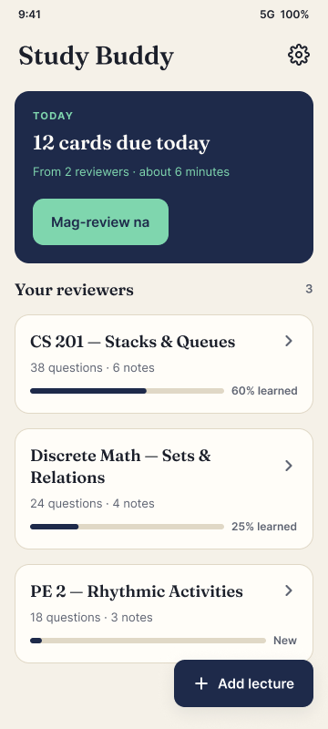
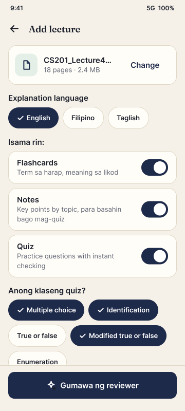
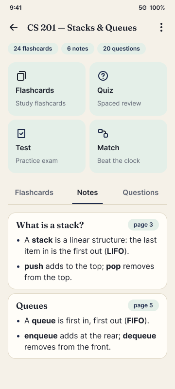
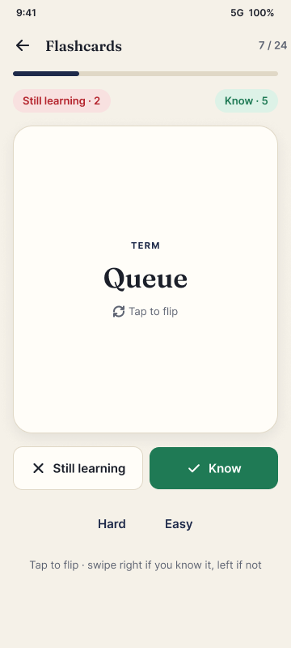
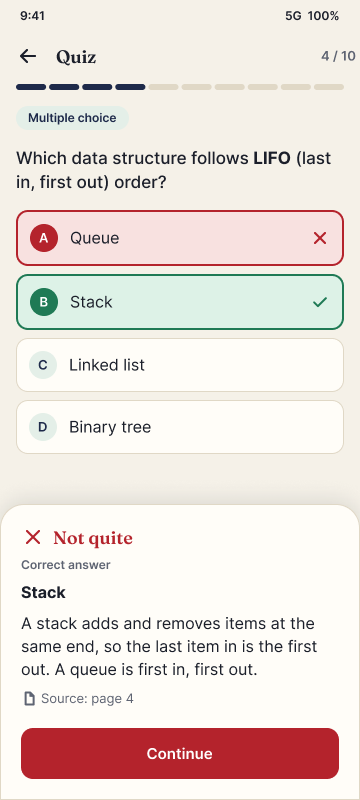
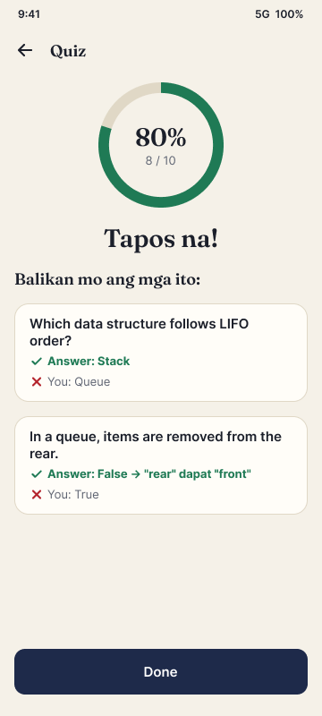
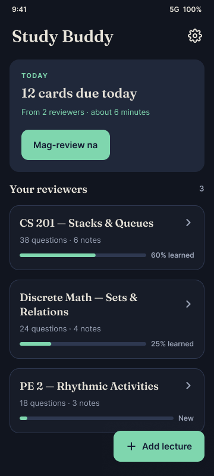
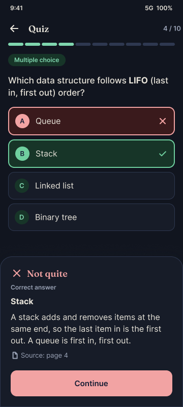
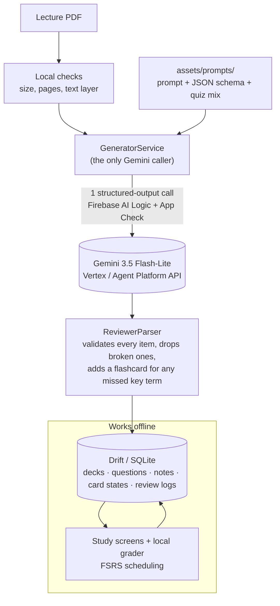

<p align="center">
  
</p>

<h1 align="center">Study Buddy</h1>

<p align="center">
  Turn your own lecture PDFs into a <b>Filipino-style reviewer</b>: flashcards, notes and a quiz with
  identification, enumeration, modified true or false and more, with explanations in English, Filipino or Taglish.
  <br>Generated once with Gemini, then studied <b>fully offline</b> with spaced repetition.
</p>

<p align="center">
  Flutter · Firebase AI Logic (Gemini) · Drift (SQLite) · FSRS · Android
</p>

---

<table>
  <tr>
    <td align="center"><br><sub>Home: what's due today</sub></td>
    <td align="center"><br><sub>Pick what the reviewer contains</sub></td>
    <td align="center"><br><sub>Notes with bold key terms</sub></td>
    <td align="center"><br><sub>Flip and swipe flashcards</sub></td>
  </tr>
  <tr>
    <td align="center"><br><sub>Instant feedback + explanation</sub></td>
    <td align="center"><br><sub>Score and what to review</sub></td>
    <td align="center"><br><sub>Dark mode</sub></td>
    <td align="center"><br><sub>Dark mode quiz</sub></td>
  </tr>
</table>

<sub>Screens from the Figma design the app is built from ("Calm Notebook"); see <a href="docs/mockups.md">docs/mockups.md</a>.</sub>

## Why

Apps like Quizlet, Knowt and Gizmo turn notes into flashcards and multiple choice, in English. But Filipino college
quizzes look different: **identification**, **enumeration**, **true or false** and **modified true or false**
("check the underlined word, and if it's wrong, write the right one"). Filipino reviewer apps exist, but they sell
pre-made board-exam material, not *your* lectures.

Study Buddy takes the PDF your instructor gave you and builds the reviewer you would have written by hand, in the
quiz formats you'll actually see.

## Features

- **Your lecture → reviewer in ~15 seconds.** Pick a PDF; choose the quiz types, flashcards and/or notes, and the explanation language.
- **Pinoy quiz formats**, graded on the phone:
  - identification with typo tolerance (but "DNS" ≠ "DNA");
  - enumeration in any order, with partial credit;
  - multiple choice and true or false;
  - modified true or false in the classic underline style.
- **One flashcard for every key term** in the lecture, plus **notes** by topic with the key terms in **bold**.
- **Explanations in English, Filipino or Taglish**, each with the source page.
- **Study modes:** spaced review (FSRS), Flashcards (flip, swipe), Quiz, Test (practice exam with a score) and Match (beat the clock).
- **Offline-first:** internet is only needed to generate a reviewer. Everything else works on the jeep or in airplane mode.
- **Accessible:** right/wrong is never shown by colour alone (✓ / ✗ and screen-reader labels), tap targets ≥ 48 dp, body text ≥ 16 sp, light and dark mode, and every animation turns off with Android's "Remove animations".

## How it works



- **One call per lecture.** The PDF goes to Gemini with a prompt and a strict JSON schema (structured output). Nothing
  else ever calls the AI: grading, scheduling and studying are plain Dart on the phone.
- **The prompt and schema are files** in `assets/prompts/`, shared by the app and the eval script, so what's
  evaluated is exactly what ships.
- **Never trust model output.** `ReviewerParser` checks every item against the per-type rules and drops broken
  ones instead of crashing. Examples: a multiple-choice answer must be one of exactly 4 choices, and an underlined
  word must appear in the statement.
- **No backend.** Firebase AI Logic is called straight from the app, protected by **App Check**, so a copied API key
  alone can't spend the credits. Data stays on the phone.

The full reasoning, with 10 decision records (ADRs) and an "add later" list, is in
[docs/architecture.md](docs/architecture.md).

## Evals: prompt engineering with a scoreboard

`evals/run_eval.py` runs the **same prompt and schema** as the app on 9 real lectures from 4 subjects, then scores each deck on:

| Check | What it measures |
|---|---|
| validity | items that pass the same rules as the app's parser |
| grounding | answers that can be found in the PDF text (fuzzy match) |
| mix | how close the quiz-type mix is to what was asked |
| uniqueness | no near-duplicate questions |
| language | explanations really are in English / Filipino / Taglish |
| notes | valid note sections with headings found in the PDF |
| terms | key terms bolded in the notes that got their own flashcard |

Some results from the history in [docs/process.md](docs/process.md):

| Change | Model | Score | Cost / deck |
|---|---|---|---|
| Prompt v1 | Gemini 3.8 Flash | 94.5% | $0.023 |
| v3: `correction` made a **required** field | Gemini 3.8 Flash | 97.9% | $0.027 |
| v3 | **Gemini 3.5 Flash-Lite** ✅ chosen | 97.6% | $0.008 |
| One flashcard per key term (ADR-010), new *terms* check | Gemini 3.5 Flash-Lite | 91.8% * | $0.016 |

\* The *terms* check was added in this run, so the score isn't comparable with the earlier rows.

**What the evals taught me:**
- **A schema rule beats a prompt instruction.** Gemini skipped an optional field in 18 of 20 cases, whatever the
  prompt said. Making it *required* took validity from ~90% to 100%. The same trick later made the model write
  its list of key terms first, then exactly one flashcard per term.
- **Read the examples behind a metric.** Two "bugs" in the first scores were bugs in my scorer, not in the model.
- **The cheaper model was good enough.** Flash-Lite scored within 0.3 points of Flash at about a third of the cost
  and a quarter of the time (14 s vs 58 s).

## Cost

About **$0.016 per lecture** (Gemini 3.5 Flash-Lite, a 10–40 page PDF with notes, a quiz and up to 60 flashcards).
Studying is free and offline. Spending is watched with a $10/month Google Cloud budget alert, and
`maxOutputTokens` caps every response.

## Tech stack

| Part | Choice |
|---|---|
| App | Flutter (Dart), Material 3, Riverpod; Android first |
| AI | Firebase AI Logic → Gemini 3.5 Flash-Lite (Vertex / Agent Platform API), structured output |
| Protection | Firebase App Check (Play Integrity; debug provider on my own device) |
| Data | Drift (SQLite) with tested, step-by-step schema migrations |
| Scheduling | [`fsrs`](https://pub.dev/packages/fsrs) (Free Spaced Repetition Scheduler) |
| Design | Figma design system: Light/Dark tokens, Fraunces + Inter (bundled), motion spec |
| Evals | Python 3.12, `uv`, `google-genai`, `pypdf`, `rapidfuzz` |
| CI | GitHub Actions: `flutter analyze` + `flutter test` |

## Project layout

```
lib/
  services/     generator_service.dart (Gemini), reviewer_parser.dart, grader.dart, scheduler.dart
  data/         database.dart (Drift tables, queries, migrations)
  features/     home, add_lecture, decks, study (quiz, flashcards, test, match), settings, onboarding
  widgets/      shared design-system widgets, motion helpers, logo
  theme.dart    design tokens (colours, spacing, radius, motion) from Figma
assets/prompts/ prompt, JSON schema and quiz mix, shared with the evals
evals/          run_eval.py and saved results
test/           165 tests: grader, parser, scheduler, database + migrations, widgets
docs/           architecture (ADRs), process log, design notes, screenshots
```

## Run it yourself

You need Flutter 3.50+, an Android phone or emulator, and your own Firebase project. The one in this repo is locked
by App Check.

1. Create a Firebase project on the **Blaze** plan and enable **Firebase AI Logic** with the Vertex / Agent
   Platform Gemini API (not the Gemini Developer API).
2. `flutterfire configure --platforms=android` to generate your own `lib/firebase_options.dart` and
   `android/app/google-services.json`.
3. Register **App Check**; for debug builds, add the debug token the app prints to logcat.
4. Run it:
   ```bash
   flutter pub get
   flutter test        # 165 tests, no network, never calls Gemini
   flutter run
   ```
5. Optional release build for your own phone: put your keystore details in `android/key.properties`, and your App Check
   debug token in `secrets.json` as `APP_CHECK_DEBUG_TOKEN`. Both files are gitignored. Then:
   ```bash
   flutter build apk --release --split-per-abi --dart-define-from-file=secrets.json
   ```

Evals (optional, they call Gemini and cost a few cents):
```bash
cd evals
uv run python run_eval.py --model gemini-3.5-flash-lite   # put your lecture PDFs in evals/lectures/
```

## Status

A personal study tool and portfolio project, built in phases. The build log, eval history and cost log are in
[docs/process.md](docs/process.md).

- ✅ Generation, parsing and grading; all study modes; FSRS; offline review
- ✅ Redesign from a Figma design system, with motion and dark mode; signed release APK on my phone
- ⏳ Test on a low-end Android phone · demo video
- Next (v2 candidates): scan printed handouts with the camera; share reviewers with classmates
