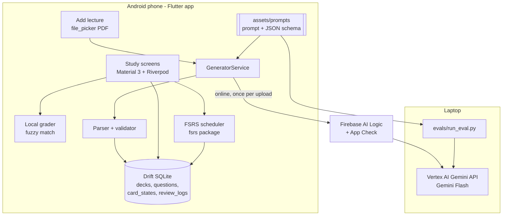

# Study Buddy (Flutter + Google Cloud) — Architecture

> Generated on 2026-11-20 | Moment: **validate** — personal study app and portfolio project; proving the reviewer generator works for one student before anyone else uses it

## Summary
An Android app, built in Flutter, that turns your own lecture PDFs into a **Filipino-style reviewer**: flashcards plus identification, enumeration, multiple choice, true or false and modified true or false questions. Each question comes with a short explanation in English, Filipino or Taglish. Gemini, called through **Firebase AI Logic**, does the work once when you upload a file. After that, everything — reviewing, grading and FSRS spaced repetition — runs **offline on the phone** from a local SQLite database. There's no backend server to run or pay for.

## Dimension Profile

```
📊 Dimension Extraction — 9/9 dimensions confident

  project_moment   ██████████ validate (0.95) ✓  personal study tool + portfolio
  product_type     ██████████ mobile   (0.95) ✓  "mobile application", Flutter
  team_size        ██████████ 1        (0.95) ✓  solo
  user_scale       █████████░ lt_1k    (0.90) ✓  "just me first" (sideloaded APK)
  monthly_budget   █████████░ low      (0.90) ✓  $80 Google Cloud credits, ~$10/mo AI Pro grant
  needs_realtime   █████████░ false    (0.90) ✓  no battles/sync in v1
  access_pattern   ████████░░ read     (0.80) ✓  write once per upload, read on every review
  has_offline      ██████████ true     (0.95) ✓  "offline review"
  latency_critical ████████░░ false    (0.85) ✓  generation may take 20–60 s with a progress screen

  ai_complexity: simple (one multimodal structured-output call per upload — not agentic, not RAG)
  compliance: none for v1 (only your own files on your own phone); Data Privacy Act (RA 10173) applies once other users join
  platform: Android first
```

## What makes it different (product scope v1)

| Gizmo / Quizlet / Knowt | Study Buddy v1 |
|---|---|
| Flashcards + multiple choice | **Pinoy reviewer formats**: identification, enumeration, true or false, modified true or false, plus flashcards and multiple choice |
| English explanations | **Explanations in English, Filipino or Taglish** (you pick a default) |
| Free tier limited (e.g., "hearts") | No limits: it's your own app |
| Weak offline study (per reviews) | **Offline-first**: generate once with internet, review anywhere |
| Pre-made board-exam reviewers (Filipino apps) | **Your own UE lectures** become the reviewer |

Out of scope for v1: exam-term planner, barkada quiz battle, accounts, cloud sync, Play Store (see Add Later).

## Architecture Diagram (ASCII)
```
┌───────────────────────────── Android phone ─────────────────────────────┐
│                                                                          │
│  Flutter app (Dart, Material 3, Riverpod)                                │
│                                                                          │
│   Add Lecture ──► file_picker (PDF ≤ 20 MB)                              │
│        │                                                                 │
│        ▼                                                                 │
│   GeneratorService ── firebase_ai ──────────────────────────┐  (needs    │
│        │  prompt + JSON schema from assets/prompts/          │  internet) │
│        ▼                                                     │            │
│   ReviewerParser + validator (reject bad items)              │            │
│        │                                                     │            │
│        ▼                                                     │            │
│   Drift (SQLite):  decks · questions · card_states · review_logs          │
│        ▲                                                     │            │
│        │                (everything below works OFFLINE)     │            │
│   Study screens: Flashcard · MCQ · Identification ·          │            │
│                  Enumeration · True/False · Modified T/F     │            │
│        │                                                     │            │
│   Grader (local fuzzy matching)   FSRS scheduler (fsrs pkg)  │            │
│                                                              │            │
└──────────────────────────────────────────────────────────────┼────────────┘
                                                               ▼
                 Firebase AI Logic  (App Check: debug provider for your phone)
                               │
                               ▼
                 Vertex AI Gemini API (Gemini Flash, structured output)
                 billed to your Google Cloud billing account (AI Pro credits)

Laptop only:  evals/run_eval.py ── same prompt + schema files ──► Vertex AI
              → scores in docs/process.md
```

## Architecture Diagram (Mermaid)


## Use Now

### Flutter (Dart) — Android first
- **Role:** the whole app: UI, local logic, storage.
- **Why now:** product_type = mobile, and you study on your phone. Flutter is Google's framework, so the Firebase SDKs (including AI Logic) are first-class. It runs smoothly on budget Androids, and the same code can ship to iOS later.
- **When to replace:** not expected to change.

### Riverpod (state management)
- **Role:** connects screens to services (generator, database, scheduler) in a testable way.
- **Why now:** a solo developer needs one clear pattern from day one. Riverpod providers also make it easy to swap in fake services in tests.
- **When to replace:** not expected to change.

### Firebase AI Logic (`firebase_ai` package) with the Vertex AI Gemini API backend
- **Role:** sends the PDF plus prompt to Gemini directly from the app and gets back structured JSON. No server needed.
- **Why now:** user_scale = just you, and ai_complexity = simple. One call per upload doesn't justify running and securing a backend. Firebase AI Logic supports PDFs (inline or by URL) and structured output from Flutter. The Vertex AI backend bills to your Google Cloud account, so AI Pro credits apply, and your lecture files aren't used for training.
- **When to replace:** add a Cloud Run backend when you need server-side logic: shared decks between users, per-user quotas beyond what Firebase provides, or multi-step generation that's too slow on a phone (see Don't Use Now).

### Gemini Flash (single model, structured output)
- **Role:** reads the lecture PDF and returns a reviewer in a fixed JSON schema. Each question has a type, prompt, answer, accepted alternative answers, choices, an explanation in your chosen language, and the source page.
- **Why now:** generation happens rarely (once per lecture), so quality matters more than price per call. Flash handles long PDFs, tables and Taglish better than Flash-Lite. At about 30 pages per lecture, a call costs a few cents.
- **When to replace:** switch to Flash-Lite if it scores within 5 points of Flash on the eval set (cheaper, faster); move up a tier only if Flash fails your quality bar on more than 20% of lectures.

### Prompt and JSON schema as asset files (`assets/prompts/`)
- **Role:** `generate_reviewer.md` (instructions) and `reviewer_schema.json` (output shape) are loaded by the app **and** by the eval script.
- **Why now:** the same files in both places means the evals test exactly what the app sends. Prompt changes are visible in git diffs.
- **When to replace:** move to Firebase AI Logic server prompt templates if you need to update prompts without shipping a new APK (once other people use it).

### Drift (SQLite) — local database
- **Role:** stores decks, questions, FSRS card states and review logs on the phone.
- **Why now:** has_offline = true. Reviews must work with no signal, and SQLite is the standard for structured offline data. Drift gives type-safe queries, migrations and easy testing in Dart.
- **When to replace:** never removed. Firestore sync is added on top later, not instead of it.

### FSRS spaced repetition (`fsrs` package)
- **Role:** decides when each question comes back for review, based on your ratings (Again/Hard/Good/Easy) or right/wrong answers.
- **Why now:** spaced repetition is the core of Gizmo-style apps. FSRS is the modern open algorithm (also used by Anki), and the Dart package is MIT-licensed, so you don't write the math yourself.
- **When to replace:** only if the package is abandoned. `dart_srs` is a fallback.

### Local grader (plain Dart)
- **Role:** checks typed answers offline: ignores case and accents, allows small typos (edit distance), accepts AI-generated alternative answers ("DNA" = "deoxyribonucleic acid"), gives enumeration partial credit in any order, and checks modified true or false in the underline style: True/False, and if False the replacement for the underlined word (ADR-007).
- **Why now:** has_offline = true and budget = low. Calling Gemini to grade every answer would cost money, need internet and be slower. Unit-tested rules are predictable.
- **When to replace:** add an optional online "Was I actually right?" AI re-check if the grader wrongly marks correct answers as wrong more than 10% of the time in your own reviews.

### App Check (debug provider for now)
- **Role:** makes sure only your app can use your Firebase AI Logic quota.
- **Why now:** Firebase AI Logic is called from the client, so the app config is inside the APK. The debug provider lets your own sideloaded phone through; the Play Integrity provider replaces it when you publish.
- **When to replace:** switch to Play Integrity on your first Play Store release.

### Firebase project on the Blaze plan + Google Cloud budget alerts
- **Role:** hosts AI Logic and App Check; billing goes to the account with your AI Pro credits. Budget: $10/month, with alerts at 50/90/100% plus forecasted spend.
- **Why now:** the Vertex AI backend needs Blaze. Budget alerts are the safety net for a usage-billed API.
- **When to replace:** not expected to change.

### Python eval script (`evals/run_eval.py`, google-genai SDK + pypdf)
- **Role:** runs the same prompt and schema over 6–10 real lecture PDFs and checks: valid JSON, correct mix of question types, answers actually found in the PDF text, no duplicate questions, explanation in the requested language. It writes a score table.
- **Why now:** this is what makes the project read as AI engineering rather than "an app that calls Gemini". It also decides the Flash vs Flash-Lite question with numbers.
- **When to replace:** add an LLM-as-judge rubric (question clarity, difficulty) once the rule checks pass at more than 90%.

### GitHub (GitHub Education) + GitHub Actions running `flutter test`
- **Role:** source control and CI for grader, parser and scheduler tests.
- **Why now:** cheap safety net for a solo developer; green checks are portfolio evidence. Free at this size.
- **When to replace:** not expected to change.

## Add Later
- **Camera scan of handwritten notes / board photos** — add when: the PDF flow passes the eval bar (≥ 85%). Not now because: get one input type right first. Gemini reads images natively, so the effort is low.
- **PPTX/DOCX import** — add when: you've had to convert slides to PDF more than 5 times. Not now because: Gemini reads PDFs natively, and "Export as PDF" is one tap. Effort: medium.
- **Firebase Auth (Google sign-in) + Firestore sync** — add when: a classmate starts testing, or you want decks on a second device. Not now because: a single user on a single phone needs neither, and Firestore bills per read. Effort: medium.
- **Exam-term planner (prelims/midterms/finals)** — add when: you have 3 or more decks and real exam dates. Not now because: FSRS already schedules reviews; the planner is a layer on top. Effort: medium.
- **Barkada quiz battle** — add when: Auth + Firestore exist and at least 5 classmates use the app. Not now because: it needs accounts and realtime sync. Effort: high.
- **Cloud Storage for Firebase (big PDFs)** — add when: any lecture PDF is over 20 MB, or uploads fail on slow data more than twice. Not now because: inline upload is simpler. Effort: low.
- **Google Play release** — add when: classmates test it (internal testing track). Not now because: it costs a $25 one-time developer fee and needs store assets. Effort: low.
- **Firebase Crashlytics** — add when: anyone besides you uses the app. Effort: low.
- **"Ask about this deck" AI tutor chat** — add when: v1 is stable and you want a second AI feature. Not now because: it's online-only and keeps costing per message. Effort: medium.

## Don't Use Now
- **A backend server (Cloud Run / FastAPI)** — one Gemini call per upload doesn't need a server; it would add deploys, auth and cost. Instead: Firebase AI Logic from the app. Reconsider when: the "When to replace" trigger under Firebase AI Logic is met.
- **Firestore / cloud sync / Firebase Auth** — user_scale = just you; local SQLite is faster, offline and free. Reconsider when: the Add Later trigger above is met.
- **Vector database / RAG / embeddings** — the whole lecture fits in Gemini's context window; chunking and retrieval would only lose context. Instead: send the full PDF. Reconsider when: you add "chat with all my subjects" across dozens of files.
- **On-device LLM (Gemma)** — too heavy for budget phones (storage, RAM, battery), and generation only happens when you're online anyway. Reconsider when: you want offline explanation re-generation and on-device models run well on ₱8,000 phones.
- **Gemini for grading every answer** — costs money per answer and breaks offline review. Instead: the local grader.
- **Leaderboards, hearts, streak-shaming gamification** — needs accounts, and it's Gizmo's weak point. Instead: a simple local "due today" count and review history. Reconsider when: barkada battle ships.
- **React Native / LangChain / Firebase Studio** — you chose Flutter; there's no chain to orchestrate; Firebase Studio is shutting down.

## Architecture Decision Records

### ADR-001: Offline-first — AI only at generation time
- **Choice:** Gemini runs once per uploaded lecture. Reviewing, grading and scheduling are local Dart code working on SQLite.
- **Why:** You study on a phone, often without signal; Philippine mobile data is expensive; per-answer AI calls would multiply cost.
- **Tradeoff:** Explanations are fixed at generation time. Switching explanation language later needs internet (one call per question, then cached).
- **Revisit when:** you add the AI tutor chat (that feature is online by design).

### ADR-002: Firebase AI Logic from the client, no backend
- **Choice:** Call Gemini through `firebase_ai` with the Vertex AI Gemini API backend, protected by App Check.
- **Why:** user_scale = just you; no server to build, deploy or pay for; credits apply.
- **Tradeoff:** The prompt ships inside the APK; less control over per-user limits.
- **Revisit when:** other users join, or generation needs multiple steps on a server.

### ADR-003: One generation call with strict structured output
- **Choice:** One request returns the whole reviewer as JSON matching `reviewer_schema.json`. The app validates every item and drops broken ones instead of failing the whole deck.
- **Why:** Simple, cheap, testable; structured output removes most parsing errors.
- **Tradeoff:** Very long lectures (over ~60 pages) may hit output limits.
- **Revisit when:** more than 10% of real lectures exceed the limit. Then split generation by page range (several calls per PDF).

### ADR-004: Pinoy reviewer formats are graded locally with explicit rules
- **Choice:** Identification uses normalised fuzzy matching plus AI-provided alternative answers. Enumeration matches sets in any order with partial credit. Modified true or false requires both the wrong word and its correction.
- **Why:** These formats are the product's main differentiator, and they must work offline.
- **Tradeoff:** Rules can be too strict or too lenient; you'll tune thresholds.
- **Revisit when:** the grader-error trigger above is met.

### ADR-005: Explanations in a chosen language, stored with each question
- **Choice:** Settings has Explanation language = English / Filipino / Taglish (default Taglish). The chosen language is generated with the deck.
- **Why:** Generating all three languages would triple output tokens for features you may not use.
- **Tradeoff:** Changing language later needs internet for existing decks.
- **Revisit when:** you find yourself switching languages often. Then generate English plus the chosen language.

### ADR-006: Prompt and schema are shared files used by both the app and the evals
- **Choice:** `assets/prompts/` is the single source of truth.
- **Why:** The evals must test exactly what the app sends.
- **Tradeoff:** None worth noting.
- **Revisit when:** you move prompts to server templates.

### ADR-007: Modified true or false uses the classic underline style (supersedes the modified T/F rule in ADR-004)
- **Choice:** Each modified true or false statement shows one **underlined word or phrase** (`underlined_word`, always present and copied exactly from the statement). The student answers True or False; if False, they type the word or phrase that replaces the underlined one (`correction`). The grader checks True/False, then fuzzy-matches `correction` with the same rules as identification. The rest of ADR-004 (identification, enumeration) is unchanged.
- **Why:** This is the format Filipino students know from quizzes and board-exam reviewers, which is the product's main differentiator. "Find the wrong word and fix it" is harder to grade (any phrase in the sentence could be picked) and isn't how local exams ask it.
- **Tradeoff:** Easier than finding the wrong word yourself, because the underline points at what to check. It also needs a visible underline in the study screen.
- **Revisit when:** you want a harder "challenge mode". Then add a setting that hides the underline, and grade `underlined_word` + `correction` together.

### ADR-008: The student chooses what each deck contains; notes come from the same single call
- **Choice:** On Add Lecture, after the explanation language, the student picks: a quiz or not, and which of 5 quiz types (multiple choice, identification, modified true or false ticked by default; enumeration, true or false optional), plus **Flashcards** and/or **Notes** (key points by topic: heading, 3–6 points, source page). At least one must be picked. The choices fill the prompt (`{{question_mix}}`, `{{target_questions}}`, `{{notes_instruction}}`). Notes come from the **same** structured-output call (ADR-003 stays: one call per PDF) through a **required** top-level `notes` array in `reviewer_schema.json`. Base type shares live in `assets/prompts/question_mix.json`, read by the app and the evals (ADR-006). Local DB schema v2 adds `note_sections` with a generated, data-checked v1 → v2 migration test.
- **Why:** Students review differently: some want only flashcards before a quiz, some want notes to read on the jeep. Generating only what they asked for also saves output tokens. One call keeps cost, latency and the offline-after-generation design unchanged.
- **Tradeoff:** Notes add output tokens (and time) when ticked. Decks generated with fewer types can't be "expanded" later without another call. The parser also drops any question type that wasn't asked for, as a safety net.
- **Revisit when:** a deck with notes regularly hits `maxOutputTokens` or takes over 60 s; then split notes into their own call.

### ADR-009: Default explanation language is English (supersedes the default in ADR-005)
- **Choice:** New installs and new decks default to **English** explanations and notes. Taglish and Filipino stay one tap away (Add Lecture, Settings). The rest of ADR-005 (one chosen language per deck, generated with the deck) is unchanged. Local DB schema v4 changes the `app_settings.language` default; the v3 → v4 step rebuilds the table and switches the untouched Taglish row to English. Migrations now use Drift's `stepByStep` with frozen per-version schemas.
- **Why:** The user's choice after using the app: lecture PDFs are in English, and English explanations read most naturally next to them. Taglish remains a feature, not the default.
- **Tradeoff:** The Filipino-first feel is now opt-in. Old decks keep the language they were made in.
- **Revisit when:** classmates (Add Later: 30–50 users) mostly switch to Taglish in Settings.

### ADR-010: One flashcard per key term, outside the quiz count (supersedes the flashcard share in ADR-008)
- **Choice:** Flashcards are no longer a share of the question mix. When Flashcards is ticked, the prompt asks for **one flashcard for every key term** the lecture defines (the same terms bolded in the notes), up to 60, on top of the quiz questions. `question_mix.json` now holds quiz types only, and `{{target_questions}}` counts quiz questions only. A new `{{flashcard_instruction}}` placeholder says whether flashcards are wanted. The schema gains a **required `key_terms` list written before `questions`**: the model lists every key term first, then writes one flashcard per entry (it reliably follows its own list; the app ignores the list itself). **Safety net in the parser:** any term bolded in the notes that still has no flashcard gets one built from its note (front: the term, back: the note point), offline and free. The parser cap rises from 60 to 100 items, and `maxOutputTokens` from 8192 to 16384. Still one call per PDF (ADR-003); no DB change. The evals add a **terms** score: the share of bolded note terms that the model itself covered (before the safety net).
- **Why:** The user saw a short lecture with about 20 bolded terms in the notes but only 4 flashcards. With a 15% share of a 10-question minimum, short lectures could never get more than a few cards. Flashcards are for memorising terms, so their count should follow the terms, not the page count.
- **Tradeoff:** More output tokens per deck (about 80 per card), so slightly higher cost and time (eval: $0.0161/deck vs $0.0106). Cards made by the safety net use the note sentence as the back, which is plainer than a written definition, and a generic word the notes wrongly bolded can become a card. A lecture with more than 60 terms keeps only the most important ones. Old decks keep their few flashcards until regenerated.
- **Revisit when:** decks often hit 60 flashcards or `maxOutputTokens`; then split flashcards into their own call or raise the limits.

## Cost Estimate
- **Monthly now (just you):** about $1–4. A 30-page lecture is roughly 8–10k input tokens and 6–10k output tokens on Gemini Flash, so a few cents per deck. Even 50 decks a month plus eval runs stays well under the ~$10/month AI Pro grant. Firebase App Check and AI Logic themselves add nothing at this scale.
- **Monthly at next stage (30–50 classmates):** about $5–20, mostly Gemini generation, plus Firestore reads once sync exists. Set per-user generation limits before inviting people.

### Cost Traps
- **Re-generating the same lecture repeatedly while testing:** cache the last response per file hash during development.
- **Scanned PDFs (images only)** cost more tokens per page and give worse questions. Warn when a PDF has no text layer.
- **Generating all three explanation languages** roughly triples output tokens (ADR-005).
- **Leaving App Check unenforced on a public APK** lets anyone who extracts the config spend your credits.
- **Using the free Gemini Developer API backend** for real lecture files: its prompts may be used to improve Google products. Use the Vertex AI backend.
- **Budgets only alert; they don't stop spending.** Check the billing page weekly while developing.

## Design Direction (user-friendly, Gizmo-like)
- Material 3 with one warm accent colour, rounded cards, big tap targets (≥ 48 dp), and dark mode from day one (you'll study at night).
- Bottom navigation: **Home** (due today, recent decks) · **Decks** · **Add** (big centre button) · **Settings**.
- One question per screen with instant feedback. A swipe-up sheet shows the explanation and the source page number.
- A clear **offline badge** on decks that are fully downloaded; a friendly progress screen while generating ("Ginagawa na ang reviewer mo…").
- Make UI mockups before coding the study screens (Phase 4).

## Agent Rules
- DO NOT add infrastructure that isn't solving a problem you have today. Moment = validate, single user.
- DO NOT add a backend server, Cloud Run, Firestore, Firebase Auth or any cloud database until an "Add Later" trigger in docs/architecture.md is met.
- DO call Gemini ONLY in `GeneratorService` (deck generation and on-demand explanation translation). Grading, scheduling and studying MUST work with the network off.
- DO load the prompt and schema from `assets/prompts/`; never inline prompt text in Dart code.
- DO validate every generated item against the schema and drop invalid items; never crash on bad model output.
- DO use the Vertex AI Gemini API backend in Firebase AI Logic, never the Gemini Developer API backend, for real lecture files.
- DO set the model name in exactly one place (`lib/config.dart`) and set `maxOutputTokens`.
- DO use Drift for all persistence; DO write a migration for every schema change.
- DO use the `fsrs` package for scheduling; DO NOT write custom spaced-repetition math.
- DO write unit tests for the grader, parser and scheduler before building their screens. Tests MUST NOT call Gemini.
- DO run `evals/run_eval.py` after any change to the prompt or schema, and log the score in docs/process.md.
- DO NOT add React Native, LangChain, a vector DB, embeddings or an on-device LLM.
- DO keep App Check enabled; use the debug provider only on your own device.
- DO NOT commit `.env` files, keystores or service account keys. (`google-services.json` is not a secret, but App Check must be enforced before the repo goes public.)
- PREFER simple, readable Dart over clever abstractions: this is a learning and portfolio repo.
- DO grade modified true or false in the underline style (ADR-007): every item MUST have `underlined_word` appearing in `prompt` (case-insensitive) and, when the answer is False, a non-empty `correction`; drop items that break this.
- DO make every new field in `reviewer_schema.json` **required** (use an empty list/string when not applicable). Gemini's constrained decoding skips optional fields even when the prompt asks for them.
- DO keep `assets/prompts/question_mix.json` as the only source of quiz-type shares; the app and `evals/run_eval.py` both read it (ADR-008). Flashcards are not in it: one per key term (ADR-010).

## Changelog
| Date | Reason | Changes |
|------|--------|---------|
| 2026-11-20 | Initial generation (moved Study Buddy from AWS + React to Google Cloud + Flutter) | — |
| 2026-11-20 | Modified true or false format chosen while designing `reviewer_schema.json` | Added ADR-007 (underline style, supersedes the modified T/F rule of ADR-004; ADR-004 left unchanged). Updated the Local grader role and added an agent rule. Schema field `wrong_word` → `underlined_word` (always present). Note: Google renamed the "Vertex AI Gemini API" to the **"Agent Platform Gemini API"**; in `firebase_ai` 5.x the backend is `FirebaseAI.agentPlatform()`. |
| 2026-11-21 | User asked to choose quiz types and add flashcards / notes per lecture | Added ADR-008 (student-chosen content; notes in the same single call via a required `notes` array; shared `question_mix.json`; DB schema v2 with `note_sections` and a tested migration). Added agent rules: new schema fields must be required; one source for type shares. ADR-003, ADR-006 unchanged. |
| 2026-11-21 | Design feedback #3: default language English | Added ADR-009 (English default; supersedes only the default in ADR-005, which is left unchanged). DB schema v4 + step-by-step migrations with frozen per-version schemas. |
| 2026-11-22 | User: a lecture with ~20 key terms got only 4 flashcards | Added ADR-010 (one flashcard per key term, outside the quiz mix; supersedes only the flashcard share in ADR-008). Parser cap 60 → 100, `maxOutputTokens` 8192 → 16384, eval "terms" coverage score. No DB or schema change. |

---
To update, run `/planfirst` again.
